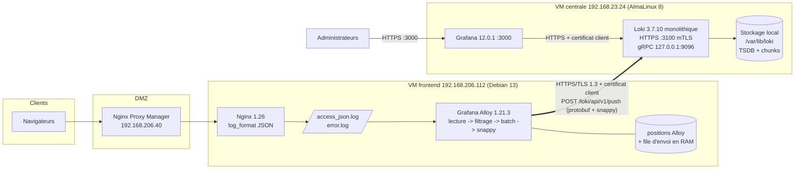

# Phase 1 — Analyse des besoins et architecture technique

> Statut : **installé et validé le 13/11/2026** (décisions au §11, résultats dans `07-tests.md`).  
> Date de l'état des lieux : 13/11/2026.

## 1. État des lieux (constaté sur les VM, en lecture seule)

| Élément | VM frontend `192.168.206.112` | VM centrale `192.168.23.24` |
|---|---|---|
| Hostname | `AH-NOC-FRONT-TEST` | `central` (bannière **PRODUCTION**) |
| OS | Debian 13 (trixie) | AlmaLinux 8.10 |
| vCPU / RAM | 8 / 7,9 Go (≈ 7,4 Go libres) | 12 / 15,7 Go (≈ 9,9 Go disponibles) |
| Disque libre | 52 Go sur `/` | 297 Go sur `/` |
| Internet | Oui (`apt.grafana.com` joignable) | **Non** → installation hors ligne |
| Accès SSH | `root` (clé) | `m.temmali` + `sudo` (`root` refusé) |
| Logiciels pertinents | Nginx 1.26.3, Next.js (127.0.0.1:3000), Uvicorn (127.0.0.1:8000) | Grafana **12.0.1** (RPM, port 3000), Podman 4.9.4, pas de Docker |
| Pare-feu | iptables, politique INPUT ACCEPT | firewalld **inactif** |
| SELinux | n/a | désactivé |
| Horloge | UTC, NTP synchronisé | à vérifier (chrony) |

Constats importants :

1. **Loki n'est pas installé** sur la VM centrale. Une datasource Grafana nommée `loki` existe déjà (pointant vers `http://localhost:3100`) mais rien n'écoute sur ce port. Proposition : créer une **nouvelle** datasource dédiée (`Loki-Nginx`) pour ne pas modifier l'existant en production.
2. **Nginx est derrière un reverse proxy.** Les appels de santé viennent de `192.168.206.40` (« NPM Manager-upstream-check » = Nginx Proxy Manager) et 92 % des lignes proviennent de `172.20.0.86`. Sans configuration `real_ip`, `remote_addr` contiendra l'IP du proxy et **le calcul des visiteurs uniques sera faux**. Analyse complémentaire : `192.168.206.40` est le Nginx Proxy Manager (il transmet `X-Forwarded-For`, il est déclaré de confiance via `set_real_ip_from`). `172.20.0.86` n'est **pas** un proxy : c'est un scanner (gobuster/ffuf) qui passe environ une fois par mois et génère des pics de 404.
3. Format de log actuel : `combined` (texte), 161 octets/ligne en moyenne, un seul `access.log` de 100 Mo (620 767 lignes depuis le 05/08/2026) → le paquet `logrotate` n'est **pas installé** sur le frontend (la configuration `/etc/logrotate.d/nginx` existe mais rien ne l'exécute). À corriger : c'est elle qui définit le **buffer local** en cas de coupure.
4. Volume réel : de 100 à 800 requêtes/jour en temps normal, jusqu'à ~26 000/jour, et un pic de **238 561 requêtes en une heure** (07/08/2026, scan : 56 % de 404 sur l'historique). Les fichiers statiques représentent ~2 % des lignes.

## 2. Versions retenues (vérifiées sur les dépôts officiels Grafana)

| Composant | Version | Justification |
|---|---|---|
| Grafana Alloy | **v1.21.3** (28/10/2026) | Dernier correctif de la branche stable. La v1.22.0 est sortie le 13/11/2026 (le jour même) : on attend quelques correctifs avant de l'adopter. Paquet `.deb` officiel. |
| Grafana Loki | **v3.7.10** (13/11/2026) | Dernier correctif de la branche 3.7 stable. Loki 4.0 n'existe qu'en RC (`v4.0.0-rc.3`) → exclu. RPM officiel `loki-3.7.10-1.x86_64.rpm` disponible → installation hors ligne simple. |
| Grafana | **12.0.1** (existant) | Conservé. Compatible Loki 3.x (datasource Loki native). |

Tous les paramètres cités ci-dessous ont été vérifiés dans la documentation **de ces versions précises** (tags `v1.21.3` d'Alloy et `v3.7.10` de Loki sur GitHub).

## 3. Schéma d'architecture



Chaîne de traitement sur chaque serveur web :

```
Nginx (JSON) → loki.source.file → loki.process → loki.write → réseau → Loki
                 lecture locale    · parse JSON         · batch (taille + délai)
                 positions disque  · suppression statiques 2xx/3xx
                                   · 4xx/5xx toujours conservés
                                   · horodatage = timestamp Nginx
                                   · limitation de débit (backpressure, sans perte)
                                                        · compression snappy
                                                        · retries infinis avec backoff
```

## 4. Nombre de VM

**Aucune nouvelle VM.**

- **N serveurs web** (aujourd'hui : 1) : on y ajoute uniquement Alloy.
- **1 VM centrale** (existante, `192.168.23.24`) : on y ajoute Loki ; Grafana y est déjà.

Point d'attention : la VM centrale est en production et héberge d'autres services (MySQL, Grafana, etc.). Loki y sera confiné par systemd (limites mémoire et CPU) et ses données seront stockées dans un répertoire dédié. Si la charge augmente fortement (> ~50 serveurs web ou > 50 Go/jour), il faudra une VM Loki dédiée.

## 5. Ressources recommandées

| Composant | CPU | RAM | Disque | Commentaire |
|---|---|---|---|---|
| Alloy (par serveur web) | < 0,1 vCPU en moyenne, plafonné à 0,5 | 80–150 Mo, plafonné à 256 Mo (`MemoryMax`) | < 100 Mo (positions) + logs Nginx locaux | Négligeable sur la VM frontend |
| Loki (VM centrale) | 1–2 vCPU (`CPUQuota=200%`) | 1–2 Go (`MemoryMax=2G`) | voir ci-dessous | Monolithique, stockage filesystem |
| Grafana | existant | existant | existant | Aucune ressource supplémentaire notable |

Estimation du stockage Loki (ligne stockée ≈ 210 octets après réécriture par Alloy, mesurée au banc ; compression des chunks ≈ ×5 ; **rétention 14 jours** ; index TSDB inclus) :

| Trafic | Brut/jour | Stocké/jour | Stocké sur 14 jours |
|---|---|---|---|
| 20 000 req/jour (actuel, journée chargée) | 4,2 Mo | ~1 Mo | ~15 Mo |
| 1 million de req/jour | 210 Mo | ~45–60 Mo | ~0,8 Go |
| 10 millions de req/jour | 2,1 Go | ~0,5 Go | ~7 Go |

Recommandation : réserver **20 Go** pour `/var/lib/loki`, idéalement sur un volume logique (LV) dédié pour qu'un remplissage n'affecte pas les autres services de production.

## 6. Flux réseau et ports

| # | Source | Destination | Port / protocole | Usage | Exposition |
|---|---|---|---|---|---|
| 1 | Serveurs web (Alloy) | `192.168.23.24` | **TCP 3100 HTTPS (TLS 1.2+, mTLS)** | Push des logs | **Uniquement** depuis les IP des serveurs web |
| 2 | Grafana (local) | `127.0.0.1` ou `192.168.23.24` | TCP 3100 HTTPS | Requêtes LogQL | Local |
| 3 | Loki | `127.0.0.1` | TCP 9096 gRPC | Interne au monolithe | Lié à `127.0.0.1` uniquement |
| 4 | Administrateurs | `192.168.23.24` | TCP 3000 (HTTPS recommandé) | Interface Grafana | Réseau d'administration |
| 5 | Administrateurs | Serveurs web | TCP 12345 (Alloy UI) | Débogage Alloy | Lié à `127.0.0.1`, accès par tunnel SSH |
| 6 | Serveurs web | `apt.grafana.com` | TCP 443 | Installation/mise à jour d'Alloy | Sortant |

Loki n'est **jamais** exposé sur Internet : il écoute sur le LAN, protégé par mTLS (certificat client obligatoire) **et** par un filtrage pare-feu limité aux IP des serveurs web.

Vérifié : la règle iptables `OUTPUT` du frontend ne bloque pas `192.168.23.24`, et le port 22 de la VM centrale est joignable depuis le frontend.

## 7. Prérequis système

**Serveurs web (Debian/Ubuntu ou RHEL-like)**
- Nginx ≥ 1.11.8 (pour `escape=json` dans `log_format`) → 1.26.3 OK.
- Accès HTTPS sortant vers `apt.grafana.com` (ou dépôt miroir interne).
- Utilisateur `alloy` membre du groupe `adm` pour lire `/var/log/nginx/*.log`.
- Horloge synchronisée par NTP (déjà OK).
- `logrotate` fonctionnel (timer systemd actif).

**VM centrale (AlmaLinux 8, hors ligne)**
- RPM `loki-3.7.10-1.x86_64.rpm` + `SHA256SUMS` transférés par `scp` (téléchargés depuis le poste d'administration ou la VM frontend).
- `openssl` (présent) pour générer l'autorité de certification (CA) interne et les certificats.
- Répertoire/LV dédié `/var/lib/loki` (20 Go).
- Ouverture du port 3100 limitée aux serveurs web : firewalld est **inactif**, donc une règle iptables ciblée sur le seul port 3100 est posée par un service dédié `loki-firewall` (décision §11).
- Horloge synchronisée (chrony) : indispensable, Loki rejette les entrées trop anciennes ou situées dans le futur.

**Pourquoi pas Docker Compose ?** La VM centrale n'a ni Docker ni accès Internet. Elle dispose de Podman 4.9 sans `podman-compose`, et Grafana y est déjà installé en RPM natif. Un RPM Loki officiel avec un service systemd est la solution la plus simple, la plus légère et la plus cohérente avec l'existant. Sur le frontend, Alloy est installé en paquet `.deb` avec un service systemd, pour la même raison. Docker Compose n'apporterait ici qu'un composant de plus à maintenir.

## 8. Choix techniques clés (et paramètres vérifiés)

### 8.1 Format de log Nginx JSON
- `log_format ... escape=json` avec les champs demandés.
- **URL sans query string** : on n'enregistre pas `$request_uri` (qui contient les paramètres). Le chemin est extrait de `$request_uri` via un `map` (le texte avant `?`). On évite aussi `$uri`, qui change après une redirection interne (`try_files`). Aucun paramètre sensible, cookie, en-tête `Authorization` ou corps de requête n'est journalisé.
- `request_time` = temps total côté Nginx ; `upstream_response_time` = temps du backend (vide `""` sans backend avec `escape=json`, ou une liste `0.010, 0.020` en cas de retry : le traitement est prévu dans les requêtes LogQL).
- Nouveau fichier `access_json.log` ; l'ancien `access.log` est conservé pendant la validation, puis désactivé pour économiser le disque.

### 8.2 Alloy : réduction de la bande passante (paramètres vérifiés dans la doc v1.21.3)

| Besoin | Mécanisme Alloy | Paramètre(s) |
|---|---|---|
| Lecture locale | `loki.source.file` + bloc `file_match` | `targets`, `file_match { enabled, sync_period }`, `tail_from_end` |
| Batching | `loki.write` > `endpoint` | `batch_wait` (délai), `batch_size` (taille max) |
| Compression | Native et non désactivable | La doc indique : « `loki.write` uses snappy for compression » (protobuf + snappy) |
| Limite de débit | `loki.process` > `stage.limit` | `rate`, `burst`, `drop = false` (**backpressure** : on ralentit la lecture, on ne jette rien) |
| Coupure réseau | `loki.write` > `endpoint` | `max_backoff_retries = 0` (= retries infinis), `min_backoff_period`, `max_backoff_period`, `remote_timeout`, `retry_on_http_429` |
| Buffer local | Fichiers Nginx + positions Alloy | Rotation logrotate (`rotate N`) = profondeur du buffer ; positions dans `--storage.path` |
| Buffer mémoire | `endpoint` > `queue_config` (*expérimental*) | `capacity`, `block_on_overflow` |
| Buffer disque | Bloc `wal` (*expérimental*) | `enabled`, `max_segment_age`, `drain_timeout` → **non activé par défaut** (fonctionnalité expérimentale), testable en option |
| Retransmissions inutiles | Fichier de positions + `on_positions_file_error` | `on_positions_file_error = "restart_from_end"` + `tail_from_end = true` au premier démarrage |
| Filtrage des fichiers statiques | `stage.drop` | `source = "uri,status"` + `expression` : suppression seulement si extension statique **et** statut 2xx/3xx → 4xx/5xx toujours conservés |
| Pas de sampling | — | `stage.sampling` **non utilisé** |
| Protection des données | `stage.template` | `Hash` (SHA3-256 salé) pour produire un `visitor_id` pseudonymisé |

Il n'existe **pas** de paramètre Alloy limitant le débit en octets/seconde. Le plafonnement se fait en lignes/seconde (`stage.limit`). Si une limite stricte en kbit/s est exigée, on peut ajouter une règle `tc` (iproute2, déjà présent sous Linux) sur le flux vers le port 3100, sans composant supplémentaire. C'est proposé en option.

### 8.3 Loki : stockage et cardinalité (paramètres vérifiés dans la doc v3.7.10)
- Mode monolithique, `schema v13` + `tsdb`, `object_store: filesystem`, sans MinIO.
- Rétention : `compactor.retention_enabled: true`, `delete_request_store: filesystem`, `limits_config.retention_period` (configurable, retenu : `336h` = 14 jours).
- Labels **uniquement** : `site`, `environment`, `hostname`, `application`, `job`. Désactivation de la découverte automatique (`discover_service_name: []`, `discover_log_levels: false`) pour ne pas ajouter de labels ou métadonnées implicites.
- IP, URL, statut, user-agent : **jamais en label**, ils sont analysés au moment de la requête (`| json`).
- Cache de résultats intégré (`results_cache.embedded_cache`), `split_queries_by_interval`, `max_query_series`, `query_timeout`.
- TLS serveur : `server.http_tls_config` (`cert_file`, `key_file`, `client_auth_type: RequireAndVerifyClientCert`, `client_ca_file`) → **authentification par certificat client (mTLS)**, sans reverse proxy supplémentaire. `grpc_listen_address: 127.0.0.1`.
- `analytics.reporting_enabled: false` (VM hors ligne, et pas de télémétrie sortante).

### 8.4 Visiteurs uniques (confidentialité et charge)
- Visiteur estimé = empreinte `Hash(IP + User-Agent + sel)` calculée **sur le serveur web** par Alloy (`visitor_id`). Le distinct-count se fait au moment de la requête : `count(sum by (visitor_id) (count_over_time(... | json visitor_id [$__range])))`.
- Limite rappelée sur le dashboard : une IP ≠ un utilisateur (NAT, proxy, mobile).
- Top 20 des IP : l'IP complète n'est pas conservée (décision §11). Alloy la tronque avant l'envoi (`/24` en IPv4, `/48` en IPv6) : le dashboard affiche donc un **top 20 des réseaux clients**.

## 9. Estimation du trafic réseau de la collecte

**Mesure au banc** (pipeline Alloy réel, mTLS, 10 160 lignes dont 620 statiques/sondes) : Nginx a écrit 4,03 Mo ; après filtrage et réécriture, 2,17 Mo à envoyer ; **0,48 Mo réellement transmis en 3 requêtes HTTPS**. Cela donne une compression snappy de ×4,5 et **~93 octets par ligne sur le réseau** (TLS inclus), contre ~400 octets bruts.

| Scénario | Lignes | Brut Nginx | Sur le réseau (~93 o/ligne) | Débit moyen |
|---|---|---|---|---|
| Journée normale actuelle | 800/jour | 320 Ko | ~75 Ko/jour | négligeable |
| Journée chargée actuelle | 26 000/jour | 10 Mo | ~2,4 Mo/jour | ~0,2 kbit/s |
| Pic observé (scan) | 238 561/heure (66/s) | 95 Mo/h | ~22 Mo/h | **~50 kbit/s** pendant le pic |
| Hypothèse 1 M req/jour | 1 000 000/jour | 400 Mo | ~93 Mo/jour | ~9 kbit/s en moyenne |

Avant/après optimisation :
- **Sans optimisation** (lignes brutes, non filtrées, non compressées) : au minimum le volume brut Nginx, auquel s'ajoute le surcoût HTTP/TLS de chaque petite requête.
- **Avec optimisation** : environ **4 à 5 fois moins** d'octets, avec au plus 1 requête HTTPS toutes les 5 s (ou par Mio). Les statiques 2xx/3xx sont supprimés (~2 % aujourd'hui, beaucoup plus sur un site riche en assets). La mesure sur la VM réelle se fait avec `tests/bandwidth_measure.sh` (voir `07-tests.md`).

Pour une contrainte de bande passante encore plus forte, le levier principal est `batch_wait` (ex. 30 s) : moins de requêtes et une meilleure compression, au prix d'une latence d'affichage plus élevée dans Grafana.

## 10. Risques identifiés

| Risque | Impact | Mitigation |
|---|---|---|
| IP du proxy au lieu de l'IP client | Visiteurs uniques et top IP faux | `set_real_ip_from 192.168.206.40` + `real_ip_header X-Forwarded-For` (validé sur le Nginx réel) |
| Coupure réseau plus longue que la conservation locale | Lignes perdues si le fichier est supprimé avant d'être relu | logrotate `rotate 7` = 7 jours de buffer local ; backpressure (Alloy suit l'ancien fichier jusqu'au bout) ; testé au banc avec rotation pendant la coupure : 0 perte |
| Redémarrage d'Alloy pendant une coupure | Lignes du batch en cours renvoyées (doublons possibles, pas de perte) | Positions enregistrées sur disque ; WAL expérimental non activé |
| Scan de dizaines de milliers d'URLs inconnues | Tableau « 404 par URL » en erreur de limite | Tableaux par URL hors 4xx ; `max_query_series = 50000` ; tableau « 404 par réseau client » |
| Entrées > 7 jours rejetées par Loki | Perte au-delà de `reject_old_samples_max_age` | Valeur configurable ; alerte si la file d'envoi grossit |
| VM centrale de production | Concurrence de ressources | Limites systemd `MemoryMax` / `CPUQuota`, LV dédié |
| firewalld inactif sur la VM centrale | Port 3100 visible sur tout le LAN | mTLS obligatoire + chaîne iptables `LOKI_INGRESS` (port 3100 uniquement) |
| Le RPM Loki démarre Loki automatiquement à l'installation (sans TLS) | Port 3100 ouvert sans authentification pendant quelques minutes | Pare-feu posé **avant** l'installation du RPM, puis arrêt immédiat du service (`02-installation.md`) |
| Ancien `access.log` de 100 Mo non tourné | Disque, première lecture | Alloy lit uniquement le nouveau fichier JSON ; installation de logrotate |
| Requêtes LogQL coûteuses sur de longues périodes | CPU/RAM de Loki | Filtres de ligne avant `| json`, `json` avec champs ciblés, cache, `max_query_series` |

## 11. Décisions prises

| Question | Décision |
|---|---|
| Proxys de confiance | `192.168.206.40` (Nginx Proxy Manager) uniquement ; `172.20.0.86` est un scanner, pas un proxy |
| Conservation des IP | IP **tronquée** (`/24`) + empreinte visiteur pseudonymisée (`visitor_id`, SHA3 salé) |
| Rétention Loki | **14 jours** (`retention_period: 336h`) |
| Pare-feu VM centrale | Règle iptables ciblée sur le **port 3100 uniquement** (firewalld reste inactif) |
| Fichiers statiques | **Supprimés**, sauf en 4xx/5xx |
| Méthode | Configurations rédigées et testées au banc (phase 2) **avant** toute installation, soumises à validation |
